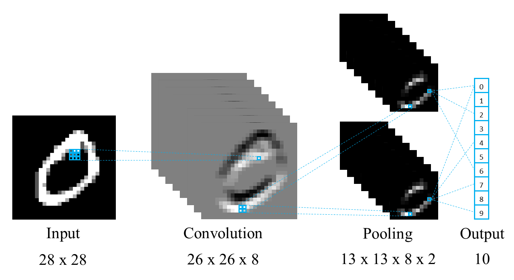

# Matrix implementation of Anti-spike Spiking Neural P Systems for Image Classification

This project originated from the work of me, [Sandro Erba](https://github.com/SandroErba), Giuditta Franco and Claudio Zandron.

> [!NOTE]
> This is the repository for the 2026 ICMC paper "A matrix-based and GPU-accelerated simulator for ASNP systems".

## Overview

This project extends the Anti-spike Spiking Neural P (ASNP) system model applied to image classification tasks, originally developed in [Sandro Erba's previous work](https://github.com/SandroErba/spiking-p-system).

The project has been developed in collaboration between the University of Milano-Bicocca and the University of Verona.

The initial codebase is a fork of:
https://github.com/a1sabau/spiking-p-system

and is subsequently an extract of the work by Sandro Erba and Matteo Balzerani in:
https://github.com/SandroErba/spiking-p-system

## Content

This repository extends the Anti-spike Spiking Neural P (ASNP) system model for image classification. The project is written directly in Python and is not based on a DSL language. It supports both small example systems and a multilayer architecture for structured inputs such as images.

The framework includes:

- OOPSNPS, the object-oriented implementation, handled in [sps/snp_system.py](sps/snp_system.py) and based on [sps/spike_utils.py](sps/spike_utils.py), [sps/p_neuron.py](sps/p_neuron.py), and [sps/handle_csv.py](sps/handle_csv.py)
- MSNPS(GPU), the matrix-based implementation for GPU, handled in [sps/m_snp_pytorch_exact_GPU_and_CPU.py](sps/m_snp_pytorch_exact_GPU_and_CPU.py)
- MSNPS(CPU), the matrix-based implementation for CPU, handled in [sps/m_matrix_executor_exact.py](sps/m_matrix_executor_exact.py)
- shared classes used by all implementations, collected in [sps/config.py](sps/config.py), [sps/digit_image.py](sps/digit_image.py), and [sps/network.py](sps/network.py)

The multilayer architecture used for image classification is illustrated below:



## Installation

Clone the repository:

```bash
git clone https://github.com/MatteoBalzerani/matrix-spiking-neural-p-system.git
cd matrix-spiking-neural-p-system
```

Create a virtual environment (optional but recommended):

```bash
python -m venv venv
source venv/bin/activate  # Linux / Mac
venv\Scripts\activate     # Windows
```

Install dependencies:

```bash
pip install -r requirements.txt
```

## Usage

Run the main entry point with:

```bash
python main.py
```

Experiments can be executed by changing the parameters directly in the code.

